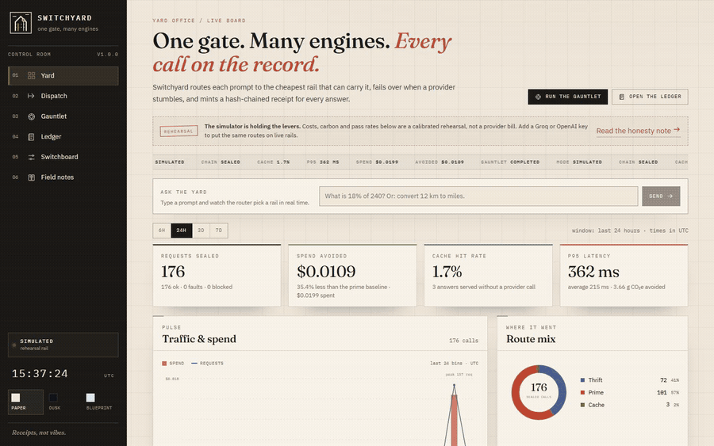
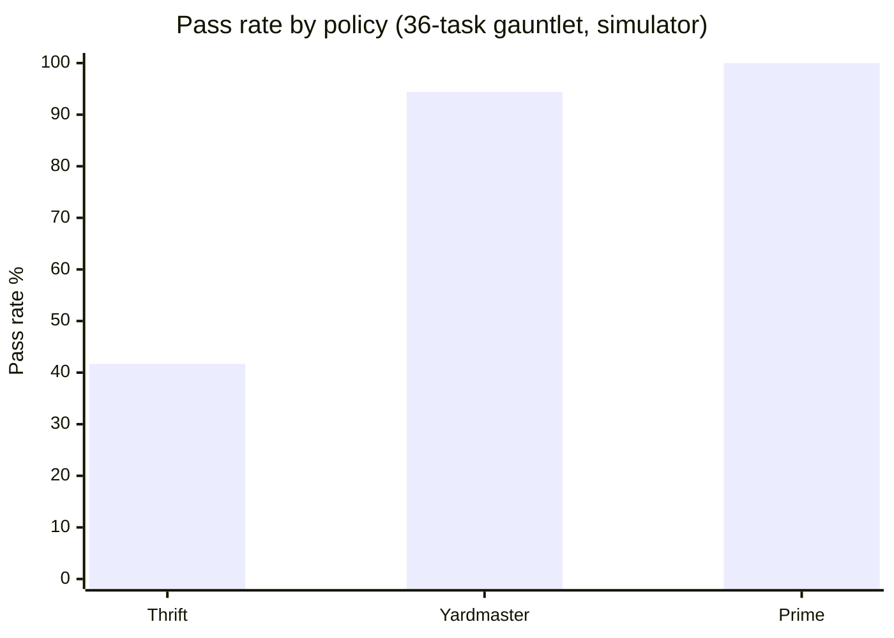
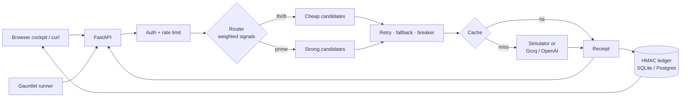
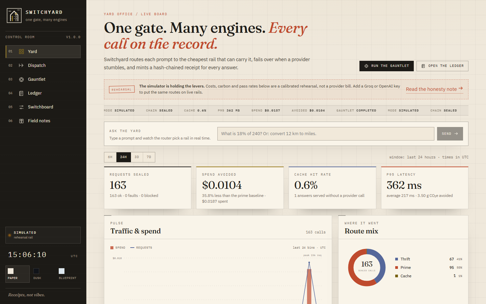
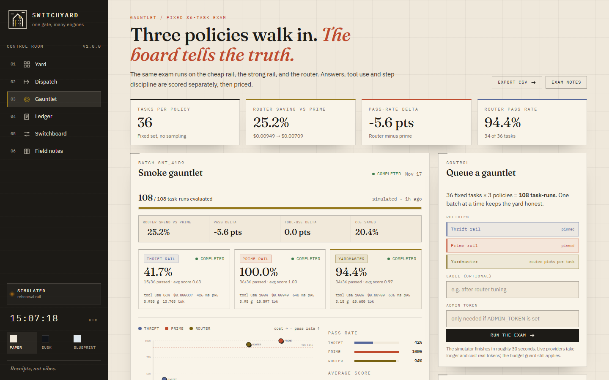
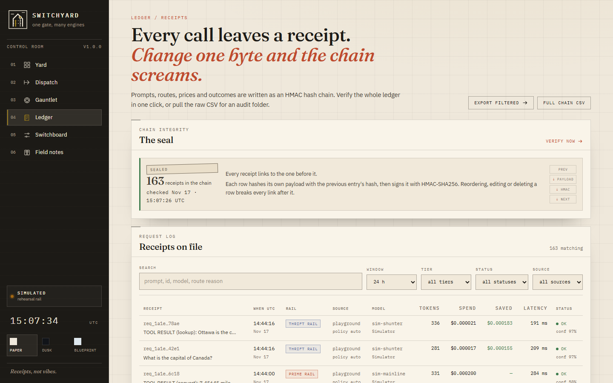
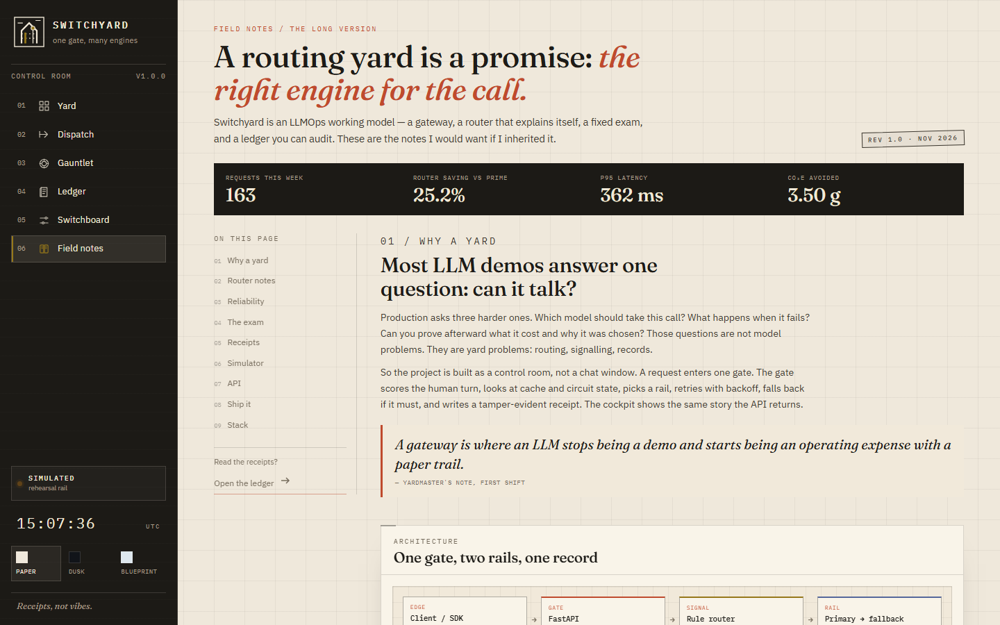

# Switchyard

**One gate, two rails, one record.** An LLM gateway where every routing decision
is explained, every receipt is tamper-evident, and "cheaper" is a claim the repo
can defend on a scored exam.


Most routing demos show a cheaper bill. They rarely show what the cheap route
got wrong, how many retries it quietly swallowed, or whether the ledger can be
edited after the fact. Switchyard treats those as the actual product:

* **Route in the open.** A deterministic weighted scorer picks `thrift` or
  `prime`, then explains the decision with contributions and a confidence.
* **Survive failure.** Jittered retries, cross-provider fallback, a three-state
  breaker, an exact-match cache, and a daily budget guard — all visible in the
  receipt.
* **Prove the trade.** The same 36-task agent exam runs under always-cheap,
  always-strong, and router policies. CI fails if routing regresses.
* **Make receipts hard to fake.** Each row is chained with HMAC-SHA256;
  `/api/ledger/verify` recomputes the chain and points at the first broken link.

No key? It still runs. A deterministic simulator holds the levers and says so on
every screen, so the demo, the tests, and the CI gate work before you spend a cent.

[](docs/media/switchyard-demo.mp4)

*A real screen recording of the local simulator — no mockups. It dispatches an
agent run, opens its receipt, inspects the gauntlet and a task sheet, verifies the
ledger seal, probes the switchboard, and cycles all three themes. Click the
preview for the 3.3 MB MP4; the inline GIF is 5.2 MB.*

---

## The number that matters

36 tasks · 9 categories · same exam, three policies (`python scripts/policy_gate.py`):

| Arm | Pass rate | Avg score | Cost, 36 tasks | Share of prime spend |
|---|---:|---:|---:|---:|
| Thrift (always cheap) | 41.7% | 0.63 | $0.000837 | 8.8% |
| **Yardmaster (router)** | **94.4%** | **0.97** | **$0.007094** | **74.8%** |
| Prime (always strong) | 100.0% | 1.00 | $0.009487 | 100% |

The router keeps **94.4% of prime's pass rate for 74.8% of its spend** — 25.2%
saved, −5.6 points. The cheap rail alone saves 91% and loses 58 points. That
second row is why a router exists and a price cut does not.



> The simulator is deterministic and prices come from an editable sheet in
> `app/gateway/cost.py`. With a provider key, the same pipeline records real
> usage from the response. The rehearsal is labelled as a rehearsal everywhere;
> it is not a bill.

---

## For reviewers: a 12-minute path

Everything below is copy-paste. No provider key, cloud account, or database server
is required. Times assume the Docker image or the local venv is already up.

| Minutes | Do this | What it proves |
|---|---|---|
| 0–2 | `docker compose up --build` or the local quickstart, then open `http://localhost:8000` | The cockpit, API, and simulator boot together |
| 2–4 | `pytest -o addopts="" -q` and `python scripts/policy_gate.py` | 92 tests pass; the router beats the cheap rail and saves 25.2% vs prime |
| 4–6 | `python scripts/smoke.py` | 22 live HTTP checks cover every API surface, including the ledger and admin levers |
| 6–8 | **Dispatch** → click **Unit change** → **Dispatch agent** → click a receipt link | An agent tool loop, explained route, priced call, and tamper-evident receipt |
| 8–10 | **Gauntlet** → click any task ID → **Queue a gauntlet** | The same exam under three policies; the new task sheet endpoint behind each row |
| 10–12 | **Ledger** → **verify now** → filter/search → **Export CSV**; then **Switchboard** → arm a squall and dispatch again | A recomputed HMAC chain and a visible retry/fallback trail |

Optional 13th minute: the [tamper drill](#tamper-drill) edits a copied database
and watches the chain report the exact broken row.

---

## Architecture



A request is routed on its human turns only, priced against the strong baseline,
checked against the cache, dispatched through the reliability ladder, and written
to the ledger with its route trace. Deep dive: [docs/architecture.md](docs/architecture.md).

### Why the cheapest decision is not the best decision

The scorer never sees a model. It sees signals:

```
"What is the capital of Canada?"
  thrift  score -0.14  conf 0.97  single lookup-style question

"Write a Python function that deduplicates a list while preserving order."
  prime   score  0.62  conf 0.97  structured guidance (+0.34), code-shaped (+0.28)

"Convert 12 kilometers to miles."
  prime   score  0.34  conf 0.58  unit conversion needs precision (+0.34)
```

Threshold **0.33**. Confidence grows with distance from it. A code fence alone is
+0.40; a greeting is −0.30. The threshold is deliberately conservative because
routing up wastes money while routing down fails work. `cheap`, `strong`,
`yardmaster`, and `router` are aliases, not separate code paths; a catalog model
id pins the call with confidence 1.0. Every contribution is persisted, so "why
did this cost 14× more?" has a one-line answer.

---

## Quickstart

### Prerequisites

| Tool | Version | Needed for |
|---|---|---|
| Python | 3.11+ (CI uses 3.12) | API, tests, gate, smoke script |
| Node.js | 22+ | Building the React cockpit (not needed if you use Docker) |
| Docker | 24+ | The one-command path and the CI image job |

### Option A — Docker (app + Postgres + Redis)

```bash
docker compose up --build
# open http://localhost:8000
```

The first build takes roughly 2–4 minutes. The app waits for Postgres and Redis
health checks, then serves the built cockpit and API on port 8000. No provider key
is required; without one the simulator answers and labels itself on every screen.

```bash
docker compose down          # stop
docker compose down -v       # stop and wipe the Postgres volume
```

Compose injects `DATABASE_URL` and `REDIS_URL`; `.env` is optional and read if
present. Set a real `LEDGER_KEY` before sharing a deployment — the default
compose key only exists for local rehearsal.

### Option B — Local, no key, no Docker

```bash
python -m venv .venv
source .venv/bin/activate          # Windows PowerShell: .venv\Scripts\Activate.ps1
pip install -r requirements-dev.txt

cd web && npm ci && npm run build && cd ..
uvicorn app.main:app --reload --port 8000
```

Open `http://127.0.0.1:8000`. The first boot creates `switchyard.db` in the project
root. An `.env` file is optional — copy `.env.example` if you want to change
defaults:

```bash
cp .env.example .env               # Windows: copy .env.example .env
```

Keep keys in `.env`, never in code: `.env` is listed in `.gitignore`, while
`.env.example` is the tracked template with empty secrets.

### Option C — Frontend hot reload

Run the API and Vite in two terminals:

```bash
# terminal 1
uvicorn app.main:app --reload --port 8000

# terminal 2
cd web && npm run dev              # http://localhost:5173
```

Vite proxies `/api`, `/v1`, `/health`, `/metrics`, `/docs`, and `/openapi.json` to
port 8000. The production server serves `web/dist`, so after changing frontend
code run `npm run build` again if you are not using the dev server.

### Configuration

All knobs live in `app/config.py` and are read from the environment or `.env`.
The ones that matter for a demo:

| Variable | Default | Effect |
|---|---|---|
| `PROVIDER_MODE` | `auto` | `auto` goes live when a key exists, otherwise simulates; `live` prefers a key; `simulated` never calls out |
| `GROQ_API_KEY`, `OPENAI_API_KEY` | empty | Add either to record real usage; no key keeps the deterministic simulator |
| `GATEWAY_API_KEY` | empty | When set, `/v1/chat/completions` requires `Authorization: Bearer …` |
| `ADMIN_TOKEN` | empty | When set, admin levers and batch starts require `X-Admin-Token` |
| `LEDGER_KEY` | dev key | HMAC key for the receipt chain; rotate it and old receipts intentionally stop verifying |
| `DAILY_BUDGET_USD` | `5` | Auto-prime routes downgrade when the day's allowance is tight; cache misses return `402` when it is gone |
| `RATE_LIMIT_RPM` | `120` | Per-client requests per minute; `429` responses carry `Retry-After` |
| `CACHE_TTL_S` | `3600` | Exact-match cache lifetime |
| `MAX_RETRIES` | `2` | Retries before fallback |
| `BREAKER_THRESHOLD` / `WINDOW_S` / `COOLDOWN_S` | `3 / 60 / 20` | Breaker trip and half-open timing |
| `STORE_PROMPTS` | `false` | Keep full prompts off disk; receipts still store a preview and hash |
| `DATABASE_URL` | `sqlite+aiosqlite:///./switchyard.db` | Postgres is drop-in (`postgresql+asyncpg://…`) |
| `SERVE_FRONTEND` | `true` | Serve the built cockpit from `/` |
| `PORT` | `8000` (Docker sets it) | Listen port |

Restart the server after changing `.env`.

### Reset the demo state

Stop the server, then delete the local database files (`switchyard.db`,
`switchyard.db-shm`, `switchyard.db-wal`) and start again. That erases receipts and
gauntlet history — intentional. Queue one gauntlet from the cockpit to repopulate
the dashboard; the exam itself is fixed and needs no external data.

---

## Using the cockpit

Six pages, one design system, three themes (`paper`, `dusk`, `blueprint` — or
`?theme=dusk` in the URL).

| Page | What it answers |
|---|---|
| **Yard** | Traffic, spend, savings, route mix, daily budget, last gauntlet verdict |
| **Dispatch** | Send a prompt with/without tools; see the route, the tool trace, and the receipt |
| **Gauntlet** | Queue the 36-task exam under all three policies; compare pass/cost/carbon |
| **Ledger** | Filter receipts, open the attempt trail, verify the chain, export CSV |
| **Switchboard** | Squall (arm simulated failures), cache purge, breaker reset, provider probes |
| **Field notes** | The engineering log: why the router is rules, what broke, what's next |

### Yard

Open `/`. Read the four top tiles first: requests in the window, recorded spend,
saved spend, and p95 latency. Below them are the traffic timeline, route mix,
source mix, guardrails (budget, cache, breakers, chain), provider rail, and the
last gauntlet verdict. Every number is queried live from the ledger; refresh the
page after a dispatch to see it move.

### Dispatch — agent run and receipt

1. Click **Unit change** in "Load a proven prompt". The prompt becomes
   `What is 12 kilometers in miles?` and **Tools** turns on automatically.
2. Click **Dispatch agent**. The simulator answers `7.45645 miles`, and the right
   column shows two steps: a `convert` tool call and the answer.
3. Read **Why the final rail**: score `0.34`, threshold `0.33`, confidence `58%`,
   with the unit-conversion contribution and the matched rules.
4. Click either **receipt** link at the bottom of the answer. The drawer shows the
   prompt, route features, every attempt, token/cost/CO₂ meters, and the
   `prev → entry` hash pair. Press **Esc** to close.
5. Try an open-prose prompt. In simulator mode it returns a labelled canned
   answer; the page states that live prose needs a Groq or OpenAI key.

### Gauntlet — the exam and the task sheet

1. Open `/gauntlet`. The newest batch auto-loads; the board shows each policy's
   pass rate, spend, p95 latency, and CO₂.
2. Scroll to **Every task, every score**. Click any task ID (for example `q01`).
   The new **task sheet** drawer is backed by `GET /api/evals/tasks/{id}`: prompt,
   reference answer, step budget, tools gate, designer note, and the router's
   predicted rail with contributions.
3. Close the sheet, then **Queue a gauntlet** in the right column. Leave the admin
   token blank when `ADMIN_TOKEN` is unset. Three policies × 36 tasks finish in
   roughly 30 seconds on the simulator; the page polls until the batch completes.
4. **Export CSV** downloads every per-task score for the selected batch. With no
   batch selected the button is labelled **Task set (JSON)** and links to the
   task catalog instead.

### Ledger — verify and export

1. The **Chain integrity** panel shows `SEALED`, the number of receipts, and when
   it was checked. Click **verify now** to recompute the whole chain.
2. Filter by window, rail, status, or source; search by prompt, id, model, or
   route reason. Click a row to open its receipt dossier.
3. **Export filtered** writes the current filter to CSV; **Full chain CSV**
   includes `prev_hash` and `entry_hash` for offline verification.
4. If a row is edited directly in the database, the panel turns `BROKEN` and names
   the first bad receipt. The [tamper drill](#tamper-drill) reproduces this safely
   on a copy.

### Switchboard — providers and levers

1. **Probe** a provider to record an active health check and reset its breaker
   bookkeeping.
2. Set **Failures** to `2`, arm the squall, then dispatch a fresh prompt. The
   receipt attempt trail shows the simulated failures, the retry, and any
   fallback, without touching a real provider. Disarm when done.
3. **Purge cache** makes the next identical call pay full fare; **Reset all
   breakers** closes every breaker. Both actions are admin-only when
   `ADMIN_TOKEN` is set.
4. The price sheet lists every catalog model, its rail, $/M tokens, energy per 1k
   tokens, and context size — the sheet the simulator prices against.

### Field notes and themes

The engineering log explains the router, reliability ladder, exam design, and the
trade-offs behind the repo. Use the **Paper / Dusk / Blueprint** chips in the
sidebar (or append `?theme=dusk` to any URL) to switch themes; the choice is
remembered in `localStorage`.

### Inside the cockpit

| Yard | Gauntlet |
|---|---|
|  |  |

| Ledger | Field notes |
|---|---|
|  |  |

Real renders of the seeded demo (163 receipts, one completed gauntlet), captured
from the simulator — not mockups. The same pages serve the local and hosted
builds.

---

## Reliability, in order

1. **Retry** timeouts, transport errors, 429, and 5xx with `base × 2^attempt` and
   jitter. Non-retryable errors move on immediately.
2. **Fallback** through same-tier-other-provider, then other-tier. The receipt
   records every attempt; nothing is swallowed.
3. **Breaker** opens after N failures in a window, then admits exactly one
   half-open probe. Others wait for the verdict.
4. **Cache** is exact-match over normalised messages, tier, provider, model,
   temperature, and tool signature. A hit is free and auditable.
5. **Budget** downgrades an auto-prime route it can't afford and answers cache
   misses with `402 budget_exhausted` once the day's allowance is gone.

Arm the chaos lever from the cockpit (or `POST /api/admin/squall`) to watch 1–10
simulated failures walk through that ladder without breaking a real provider.

---

## Receipts you can check

```
entry_hash = HMAC-SHA256(LEDGER_KEY, canonical_json(prev_hash, receipt_fields))
```

`GET /api/ledger/verify` walks the chain, recomputes every digest, and returns
`ok`, `checked`, `broken_at`, and a sentence a human can read. Editing a cost,
token count, or hash breaks at that row. Exports: `/api/ledger/export.csv` and
`/api/requests/export.csv` (filtered). Rotating `LEDGER_KEY` invalidates old
receipts on purpose — documented in the deployment guide, never silent.

Prompts are **not stored by default** (`STORE_PROMPTS=false` keeps a preview and
hash only). Client identities are hashed. Admin levers require
`X-Admin-Token` when set; the gateway accepts an optional shared bearer key.

### Tamper drill

This edits a **copy** of the database, so the demo ledger stays intact:

```bash
# 1. copy the database
cp switchyard.db switchyard-tamper.db

# 2. edit one row before the server opens the copy
python - <<'PY'
import sqlite3
con = sqlite3.connect("switchyard-tamper.db")
con.execute("UPDATE gateway_requests SET cost_usd = cost_usd + 0.01 WHERE seq = 5")
con.commit()
con.close()
PY

# 3. boot against the copy and verify
DATABASE_URL=sqlite+aiosqlite:///./switchyard-tamper.db uvicorn app.main:app --port 8010
curl -s http://127.0.0.1:8010/api/ledger/verify
```

The response is `ok: false` with `broken_seq: 5` and a human-readable
`broken_at` that names the edited receipt. On Windows PowerShell, set the
environment variable first:
`$env:DATABASE_URL="sqlite+aiosqlite:///./switchyard-tamper.db"; uvicorn app.main:app --port 8010`.
Delete the copy when finished.

---

## Agent + exam

Three allowlisted tools: a calculator that parses a restricted AST (no `eval`,
no attribute access), unit conversion, and a static lookup. The agent loop uses a
strict protocol header (`[[SWITCHYARD_AGENT]] tools=... max_steps=N]`) plus one
JSON action per turn, so it cannot loop forever or invent a tool.

The exam is 36 tasks in 9 categories: quick-math, multi-step, units, lookup, code,
extraction, planning, safety, tricky. Scoring is **0.60 answer + 0.25 tools +
0.15 steps**, with numeric tolerance, keyword coverage, and a strict tools gate: a
task that needed a tool and skipped it fails even with a lucky answer.

`POST /api/evals/batches` runs policies asynchronously; the cockpit polls. Results
are queryable per task and exportable as CSV. The CI gate runs the full exam with
thresholds: prime ≥ 95%, router ≥ 90%, router saves ≥ 10% versus prime. Each result
row links to its task sheet (`GET /api/evals/tasks/{id}`), whose `route` block is
computed with the same scorer live traffic uses.

---

## API surface

† = admin token required when `ADMIN_TOKEN` is set.

| Method | Path | Purpose |
|---|---|---|
| `POST` | `/v1/chat/completions` | OpenAI-compatible gateway call |
| `GET` | `/v1/models`, `/api/models` | Aliases, catalog, prices |
| `POST` | `/api/dispatch` | Playground completion or agent run |
| `GET` | `/api/overview` | Dashboard aggregates, guardrails, providers |
| `GET` | `/api/requests`, `/api/requests/{id}` | Receipt list / detail |
| `GET` | `/api/requests/export.csv` | Filtered CSV |
| `GET` | `/api/providers` | Provider health and chaos state |
| `POST` | `/api/providers/{name}/probe` † | Active probe |
| `GET` | `/api/ledger/verify`, `/api/ledger/export.csv` | Chain verify / export |
| `GET` | `/api/evals/tasks`, `/tasks/{id}`, `/route-map` | Exam catalog, one task sheet, predicted routes |
| `POST` | `/api/evals/batches` † | Queue a gauntlet (`202`) |
| `GET` | `/api/evals/batches`, `/batches/{id}` | Batch list / detail |
| `POST` | `/api/evals/batches/{id}/cancel` † | Stop after the current task |
| `GET` | `/api/evals/batches/{id}/results(.csv)` | Per-task results |
| `GET` | `/api/admin/state` † | All levers in one payload |
| `POST` | `/api/admin/squall`, `DELETE /api/admin/squall` | Arm / disarm simulated failures |
| `POST` | `/api/admin/cache/purge`, `/api/admin/breakers/reset` | Ops levers |
| `GET` | `/health`, `/api/health` | Liveness and database check |
| `GET` | `/metrics/prometheus` | Prometheus text |
| `GET` | `/docs`, `/openapi.json` | Interactive API docs |

### Auth and headers

* If `GATEWAY_API_KEY` is set, `/v1/chat/completions` requires
  `Authorization: Bearer <key>`. `/api/dispatch` is rate-limited but not
  key-gated; the cockpit is same-origin.
* If `ADMIN_TOKEN` is set, every † endpoint requires `X-Admin-Token: <token>`.
  The cockpit asks for this token on the Gauntlet and Switchboard pages and keeps
  it in `sessionStorage`, never in the bundle.
* `X-Switchyard-Cache: off` (or `"cache": false` in the JSON body) bypasses the
  response cache for one call.
* Errors share one envelope: `{"error": {"message", "type", "code"}}`. Gateway
  failures add a `request_id`; `429` adds `Retry-After`; `402` means the daily
  budget, not bad auth.

### Cookbook

Set `BASE` once; on Windows use `curl.exe` and PowerShell quoting.

```bash
BASE=http://127.0.0.1:8000
```

**1. Gateway call, auto-routed**

```bash
curl -s "$BASE/v1/chat/completions" \
  -H 'content-type: application/json' \
  -d '{"model":"auto","messages":[{"role":"user","content":"Convert 12 kilometers to miles."}]}'
```

The response is OpenAI-shaped plus a `switchyard` block: `tier`, `policy`,
`cache_hit`, `fallback_used`, `attempts`, `route.score`, `route.confidence`,
`route.reasons`, `cost_usd`, `saved_usd`, `co2e_g`, `latency_ms`.

**2. Pin a rail or bypass the cache**

```bash
curl -s "$BASE/v1/chat/completions" \
  -H 'content-type: application/json' \
  -H 'X-Switchyard-Cache: off' \
  -d '{"model":"prime","messages":[{"role":"user","content":"Name the capital of Canada."}]}'
```

`model` accepts `auto`, `thrift`, `prime` (and the aliases `cheap`, `strong`,
`yardmaster`, `router`), or a catalog model id such as `sim-mainline`.

**3. Agent run with tools**

```bash
curl -s "$BASE/api/dispatch" \
  -H 'content-type: application/json' \
  -d '{"prompt":"Use the calculator tool. What is 42 + 57 + 31? Reply with the final number.","policy":"auto","use_tools":true,"max_steps":4}'
```

The `agent` object contains `answer`, `steps` (tool call, result, answer), the
`request_ids` behind those steps, token usage, cost, CO₂, and the stop reason.

**4. Overview and filtered receipts**

```bash
curl -s "$BASE/api/overview?hours=24"
curl -s "$BASE/api/requests?hours=24&tier=prime&source=playground&q=convert&limit=10"
curl -s "$BASE/api/requests/<request_id>"
```

`/api/requests` supports `hours`, `status`, `tier`, `source`, `q`, `limit`,
`offset`; the CSV export accepts the same filters (without pagination).

**5. Ledger integrity and exports**

```bash
curl -s "$BASE/api/ledger/verify"
curl -s "$BASE/api/ledger/export.csv" -o chain.csv
curl -s "$BASE/api/requests/export.csv?hours=168" -o receipts.csv
```

`/api/ledger/verify` forces a recomputation even if the cached verdict is fresh.

**6. Exams and a gauntlet batch**

```bash
curl -s "$BASE/api/evals/tasks"
curl -s "$BASE/api/evals/tasks/q02"
curl -s "$BASE/api/evals/route-map?policy=auto"
curl -s -X POST "$BASE/api/evals/batches" \
  -H 'content-type: application/json' \
  -H "X-Admin-Token: $ADMIN_TOKEN" \
  -d '{"policies":["thrift","prime","yardmaster"],"label":"reviewer run"}'
# 202 -> {"batch": {...}, "tasks_per_policy": 36}
curl -s "$BASE/api/evals/batches/<batch_id>"
curl -s "$BASE/api/evals/batches/<batch_id>/results?policy=yardmaster&passed=false&limit=20"
```

One batch runs at a time; a second POST returns `409`. The simulator finishes 108
task-runs in about 30 seconds.

**7. Chaos and ops levers**

```bash
curl -s "$BASE/api/admin/state" -H "X-Admin-Token: $ADMIN_TOKEN"
curl -s -X POST "$BASE/api/admin/squall" \
  -H 'content-type: application/json' -H "X-Admin-Token: $ADMIN_TOKEN" \
  -d '{"fails":2}'
curl -s -X DELETE "$BASE/api/admin/squall" -H "X-Admin-Token: $ADMIN_TOKEN"
curl -s -X POST "$BASE/api/admin/cache/purge" -H "X-Admin-Token: $ADMIN_TOKEN"
curl -s -X POST "$BASE/api/admin/breakers/reset" -H "X-Admin-Token: $ADMIN_TOKEN"
```

**8. Health and metrics**

```bash
curl -s "$BASE/health"
curl -s "$BASE/api/health"
curl -s "$BASE/metrics/prometheus" | head -20
```

---

## Testing

### 1. Unit and contract suite

```bash
pytest -o addopts="" -q
ruff check . && ruff format --check .
```

**92 tests, about 3 seconds, no network.** The suite covers the pipeline (cache,
retry, fallback, breaker, budget, attribution), the OpenAI-compatible provider
through `httpx.MockTransport`, the router, tools, scorers, ledger tamper
detection, every HTTP surface, the gauntlet runner, the task-sheet endpoint, and
SPA fallback behaviour. Plain `pytest -q` works too; the extra `-o addopts=""` only
restores the summary line because `-q` is already in `pyproject.toml`.

### 2. Policy gate

```bash
python scripts/policy_gate.py
```

Expected tail:

```
policy          pass     avg         cost   p95 lat
prime        100.0%    1.00    $0.009487       9 ms
thrift        41.7%    0.63    $0.000837       9 ms
yardmaster    94.4%    0.97    $0.007094      10 ms

Router vs prime: +25.2% of spend saved, -5.6 pts pass rate.

Gate passed.
```

The gate runs 36 tasks × 3 policies against a temporary database and fails if
prime < 95%, router < 90%, or router savings < 10%. It needs no key, so CI can
enforce routing quality on every push.

### 3. Full-stack smoke test

With the server running (local or Docker):

```bash
python scripts/smoke.py
```

It talks to the real HTTP server and the real ledger, not the in-process test
client. Expected summary:

```
22 passed, 0 failed, 0 skipped
```

The 22 checks cover: `/health`, `/api/health`, both model endpoints, a gateway
completion, a plain dispatch, an agent run with the calculator (answer `130`),
overview aggregates, the receipt list and detail, chain verification, both CSV
exports, the task catalog, a task sheet, the route map, batch detail/results/CSV,
provider health, admin state, a provider probe, squall arm/disarm, breaker reset,
Prometheus text, `/docs`, and the built SPA. Add `--with-gauntlet` to queue and
wait for a real 36-task router batch (~30 seconds). If the server has
`ADMIN_TOKEN` or `GATEWAY_API_KEY` set, pass `--admin-token` / `--gateway-key`
(or export the same environment variables).

### 4. CI

`.github/workflows/ci.yml` runs three jobs on every push and pull request:

| Job | What it does |
|---|---|
| **verify** | Installs Python + Node deps, runs Ruff, all 92 tests, and a production cockpit build |
| **eval-gate** | Runs the 36×3 simulator exam and enforces the pass/savings thresholds |
| **docker** | Builds the shipping image, boots it, and polls `/health` until it answers |

The Docker job means an image that cannot start fails CI before it becomes a
deploy. No secrets are required; a test that depends on a provider is a demo, not
a gate.

### 5. Manual browser checklist

After `pytest`, the gate, and the smoke script, this is the fast visual pass:

- [ ] `/` shows non-zero traffic, spend, and a `SEALED` chain guardrail.
- [ ] Dispatch sample → agent answer → receipt drawer opens and closes with Esc.
- [ ] Gauntlet task ID opens the task sheet; charts change when you filter results.
- [ ] Ledger "verify now" stays sealed; both CSV buttons download.
- [ ] Switchboard squall arm → dispatch → attempt trail shows failures/retry.
- [ ] Each theme changes the palette; the choice survives a reload.

---

## Troubleshooting

| Symptom | Likely cause | Fix |
|---|---|---|
| `Address already in use` | Another uvicorn or container owns the port | Stop it or run `uvicorn … --port 8010` (and update `BASE` in commands) |
| Frontend edits do not appear | The server serves `web/dist`, not the Vite dev server | Re-run `npm run build`, or use `npm run dev` on :5173 |
| `401 Admin token required` | `ADMIN_TOKEN` is set on the server | Paste it on Gauntlet/Switchboard, or leave `ADMIN_TOKEN` empty locally |
| `401 A valid gateway API key is required` | `GATEWAY_API_KEY` is set | Add `Authorization: Bearer …`; the cockpit's Dispatch page is not key-gated |
| `402 budget_exhausted` | `DAILY_BUDGET_USD` is spent | Raise the limit or restart with a larger budget |
| `429` with `Retry-After` | `RATE_LIMIT_RPM` exceeded | Wait, raise the limit, or use another client |
| `/health` says `simulated` despite a key | `PROVIDER_MODE=simulated` or the key is empty | Set `PROVIDER_MODE=auto` (or `live`) and restart |
| Ledger says `BROKEN` | A row was edited or `LEDGER_KEY` rotated | Expected; restore the database or keep the new key going forward |
| Gauntlet POST returns `409` | Another batch is running | Wait for it, cancel it, or let the smoke script skip |
| `docker build` fails immediately | Docker daemon is not running | Start Docker Desktop; `docker compose config` should also parse |
| Tests fail on a non-CI Python | Version outside 3.11–3.14 | Use Python 3.12 to match CI |
| Dashboard is empty | Fresh database | Queue a gauntlet and send a request; there is no hidden seed |
| `This cockpit is not connected to the API` | Static host (Vercel) has no FastAPI behind it | Deploy the API on Render/Docker, set `VITE_API_BASE_URL` to its origin in Vercel, then redeploy |
| `/gauntlet` returns 404 on a static host | Missing SPA fallback | Deploy the included `vercel.json` (or `web/vercel.json` when the Vercel root is `web`) |
| Render `/health` says `suspend-by-user` | The Render service is suspended | Resume the service in the Render dashboard, then recheck `/health` |

---

## Deploy

* **Docker**: multi-stage Node build → Python slim, non-root, healthcheck.
* **Compose**: app + Postgres 16 + Redis 7, with health gates and a named volume.
* **Render**: `render.yaml` at the repo root (Docker, `/data` disk, `/health`
  probe, secrets marked `sync:false`).
* **Vercel (frontend only)**: Vercel serves the static cockpit; it cannot run
  this FastAPI process. Deploy the API on Render/Docker first, then set
  `VITE_API_BASE_URL` to that origin in Vercel and redeploy. `vercel.json` adds
  SPA fallback so `/gauntlet`, `/ledger`, and `/notes` survive a refresh.

Full walkthrough, environment reference, scaling limits, and an ops runbook:
[docs/deployment.md](docs/deployment.md). Render config is honest about the
trade-off: the app runs one worker because cache/breaker/limiter/chaos state is
in-process; horizontal scaling needs Redis state and a Postgres advisory lock for
ledger appends.

Production checklist: set `LEDGER_KEY` (rotating it invalidates old receipts),
`ADMIN_TOKEN`, and `GATEWAY_API_KEY`; keep `STORE_PROMPTS=false` unless you need
prompt text; point `DATABASE_URL` at managed Postgres.

---

## Where I stopped, on purpose

* No streaming yet. Adding SSE means reconciling usage at stream end; until then
  the gateway is request/response.
* The cache is exact-match. Semantic caching would look better and audit worse.
* The router is hand-tuned. A learned scorer is the next step, with the rules as
  an envelope and the paired exam as the brake.
* No migration framework. The schema is still moving; `create_all` is a choice,
  not an oversight.
* Simulated numbers are a rehearsal. They prove the mechanism, not a vendor's
  bill.

More: [architecture](docs/architecture.md) ·
[deployment](docs/deployment.md) ·
[interview field notes](docs/interview-notes.md) (the bugs, trade-offs, and demo
script behind this repo).

## License

MIT — see [LICENSE](LICENSE).
