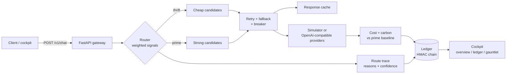
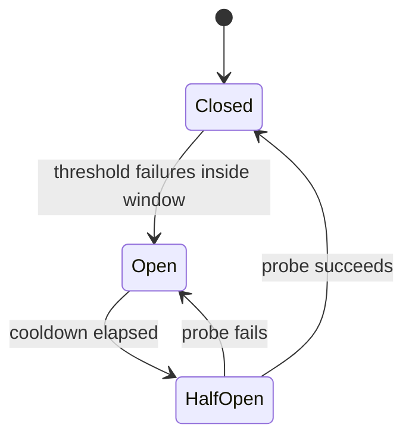

# Switchyard — architecture

Switchyard is an LLM gateway with a point of view: **the routing decision is a
product feature, not a hidden optimisation**. Every call is routed in the open,
priced against the strong-model baseline, written to a tamper-evident ledger, and
scored by the same exam whether it went to the cheap rail, the strong rail, or
through the router.



## 1. Request lifecycle

1. `POST /v1/chat/completions` validates an OpenAI-shaped body (or the cockpit
   calls `POST /api/dispatch`).
2. Auth and rate limiting run before any work: optional shared bearer key, then
   a fixed-window limiter keyed by a hashed client identity.
3. The router reads **only the human turns**. Agent scaffolding and fixed system
   prompts are overhead, not evidence about difficulty; including them would
   push every agent call uphill.
4. Budget guard: if an `auto` route wanted prime but the remaining budget cannot
   cover it, it is downgraded to thrift and the route summary says so. An
   exhausted budget still serves cache hits; a cache miss is recorded as
   `blocked` and answered with `402 budget_exhausted`.
5. Exact-match cache lookup. A hit is free, immediate, and still recorded as a
   receipt with `cache_hit=true`; `X-Switchyard-Cache: off` or `cache:false`
   bypasses it.
6. Candidates are ordered: same tier across providers first, then the other tier.
   Each retry uses exponential backoff with jitter; non-retryable errors move to
   the next candidate immediately. The circuit breaker can remove a provider for
   a cool-down window and later admits exactly one half-open probe.
7. Prices, energy, and carbon are computed from the editable sheet in
   `app/gateway/cost.py`, contrasted with what the prime baseline would have cost.
8. The outcome is persisted with its route trace (`score`, `reasons`,
   `confidence`, features) and appended to the ledger under an HMAC-SHA256 chain.
9. The API returns an OpenAI-compatible body plus a `switchyard` block containing
   the receipt id, tier, attempts, cache/fallback flags, cost, and saved amount.

## 2. The router

`app/gateway/router.py` is a small, deterministic scorer. It is intentionally not
a trained classifier: routing must be explainable in one line, testable without a
model, and editable by whoever owns the budget.

| Signal | Weight | Why |
|---|---:|---|
| code fence / inline code / code-shaped prompt | +0.40 / +0.36 / +0.28 | syntax breaks cheap models first |
| strong reasoning language | +0.24 (+0.14 for one hit) | trade-offs and proofs need capacity |
| multi-step arithmetic | +0.36 | cheap models drop intermediate results |
| structured guidance ("list steps", "summarise") | +0.34 | format compliance |
| safety-sensitive wording (secrets, billing, consent) | +0.38 | errors are expensive, route up |
| unit conversion | +0.34 | precision matters |
| long / medium brief | +0.20 / +0.10 | more context to hold |
| several questions in one turn | +0.08 | composition |
| single lookup-style question | −0.14 | cheap rail is genuinely enough |
| greeting or small talk | −0.30 | don't pay for "hi" |

Threshold: **0.33**. `confidence = min(0.97, 0.56 + |score − threshold| × 1.6)`.
The top three absolute contributions become the human-readable reason list. The
threshold is deliberately conservative: routing up is safe, routing down is not.

Policies are aliases, not new codepaths: `auto/yardmaster/router` → router,
`cheap` → thrift, `strong` → prime. A model id from the catalog pins the call
(`policy="pinned"`, confidence 1.0). That gives three honest arms for the exam:
always cheap, always strong, and the router.

## 3. Reliability



* **Retry** only on timeouts, transport errors, 429, and 5xx. Backoff is
  `base × 2^attempt` with jitter, capped so a request cannot stall the client.
* **Fallback** walks an ordered candidate list, so "the second model" means both
  the other tier and the other provider. `fallback_used` and every attempt are
  persisted, not hidden.
* **Cache** is exact-match over normalised messages, tier, provider, model,
  temperature, and tool signature. In-process by default; Redis when
  `REDIS_URL` is set. A hit costs nothing and is still auditable.
* **Breaker** keeps three states and admits one probe per half-open window.
* **Chaos** (`Squall`) can arm the next *n* simulated failures from the cockpit,
  which is how the retry/fallback path is demonstrated without breaking a real
  provider.

## 4. Receipts and the ledger

Each request row is both an audit record and a link in a chain:

```
entry_hash = HMAC-SHA256(key, canonical_json(prev_hash, receipt_fields))
```

`GET /api/ledger/verify` recomputes the chain and reports `ok`, `checked`,
`broken_at`, and a human explanation. Tampering with any cost, token count, or
hash breaks at that row. Error and blocked receipts are written with zero tokens
and zero cost so the hash computed at write time matches the database defaults.
`GET /api/ledger/export.csv` and `/api/requests/export.csv` make the data
portable. The key comes from `LEDGER_KEY`; rotating it intentionally invalidates
old receipts, which is the honest trade-off.

## 5. Agent and exam

The agent is a fixed loop with a strict protocol. The model may emit a single
JSON action inside a `[[SWITCHYARD_AGENT]] tools=... max_steps=N]` header; the
runner extracts the first JSON object, executes at most the declared steps, and
stops. Tools are deliberately boring and safe:

* `calculator` — AST-whitelisted arithmetic, no `eval`, no attribute access.
* `convert` — length, mass, volume, time, speed, temperature.
* `lookup` — stable reference facts.

The exam is 36 tasks across 9 categories (quick math, multi-step, units, lookup,
code, extraction, planning, safety, tricky). Each task carries an expected answer,
a tool requirement, and a step budget. Scoring is 0.60 answer + 0.25 tools +
0.15 steps, with a strict tools gate: a task that needed a tool and didn't use it
does not pass, even with a lucky answer. Answers are compared with numeric
tolerance and keyword coverage, never exact-string equality.

The gauntlet runs the same tasks under `thrift`, `prime`, and `yardmaster`, then
reports pass rate, average score, tool rate, latency, cost, carbon, and the
paired deltas. That paired design is the point: a routing policy is only
interesting relative to the two extremes on the same exam.

## 6. Data model

| Table | Purpose |
|---|---|
| `gateway_requests` | one row per attempt outcome, including route trace, usage, prices, and chain links |
| `eval_batches` | one exam run (label, policies, progress, terminal status) |
| `eval_runs` | one policy arm inside a batch (aggregate metrics) |
| `eval_results` | one task result (scores, answer, steps, receipt ids) |

SQLite with WAL is the default for zero-setup use. Postgres is a URL change;
tables are created on startup. There is no migration framework yet, which is an
explicit limit rather than an accident: the schema is still moving.

## 7. Security and privacy

* Keys live only in `.env` (gitignored) or the platform's secret store; the app
  never ships a key.
* `GATEWAY_API_KEY` compares bearer tokens with `hmac.compare_digest`.
* Admin levers require `X-Admin-Token` when `ADMIN_TOKEN` is set. With no token,
  admin actions are open — fine for a local demo, wrong for production.
* Prompts are **not stored by default**. `STORE_PROMPTS=false` keeps only a
  preview and hash; turning it on is an explicit decision, visible in `/api/overview`
  and `/api/admin/state`.
* Client identities are hashed before they reach the database or logs.
* The simulator is labelled everywhere, in the API metadata and the cockpit, so a
  rehearsal is never mistaken for a provider bill.

## 8. Known limits

* In-process cache, breaker, limiter, and chaos state mean **one worker**. Scaling
  horizontally requires moving those to Redis/Postgres and adding a Postgres
  advisory lock for ledger appends.
* Exact-match caching misses paraphrases by design; semantic caching would make
  the "free hit" story harder to audit.
* The router weights are hand-tuned, not learned. The exam is the guardrail: the
  CI gate fails the build if the router drops below 90% pass rate or saves less
  than 10% against prime.
* Simulated pass rates are a rehearsal with a deterministic provider, not a claim
  about any real model. Live keys produce live numbers; see
  [deployment](deployment.md) for running both.
